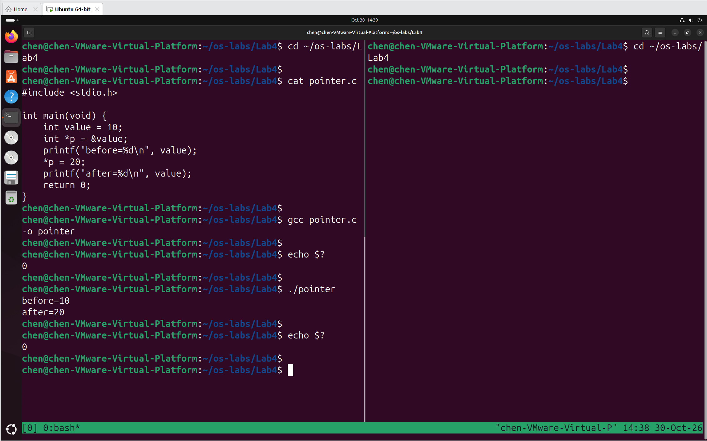
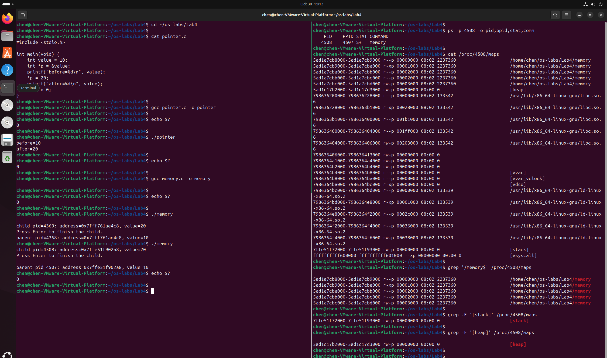

# Lab4：变量地址、父子进程与内存映射观察

> **作业目标**：先运行一个指针程序，分清变量名、地址和地址中的值；再让父子进程修改各自的变量，比较它们打印的地址和值；最后读取 `/proc/<pid>/maps`，观察 Linux 中真实的虚拟内存映射，包括代码、栈和堆。对应第 03 次课「地址空间与隔离」。
>
> **前置条件**：已完成 Lab1 至 Lab3，能在 Ubuntu 虚拟机中编译、运行 C 程序；已经读懂 Lab3 的 `fork` 返回值、父子分支和 `waitpid`。本实验继续使用 Lab3 的两个终端。
>
> **不需要会写 C**：`pointer.c` 和 `memory.c` 均由讲义给出。你只需要读懂、运行并解释结果。指针只涉及本实验出现的写法，不涉及指针算术、数组或动态内存分配；堆只作为 maps 中的区域观察，不要求编写 `malloc`/`free` 代码。
>
> **课前准备**：按任务一建好练习目录，并把 `pointer.c`、`memory.c` 按 Lab2 学过的方式送进虚拟机。
>
> **课堂用法**：前 45 分钟学习地址空间与隔离；后 45 分钟完成任务二至任务七的操作与记录。任务八、截图整理与提交在课后完成，约 30 分钟。
>
> **命令执行方式**：下面所有命令请**一条一条执行**，每执行一条就先看清它的输出再执行下一条。不要把一节里的命令一次性全部粘贴进终端，否则输出会混在一起，看不出是哪条命令出了问题。

---

## 任务一：准备练习目录和两个终端

练习在虚拟机的 Ubuntu 里做，报告在自己的电脑上填，两边的文件不是同一份。

| 目录 | 在哪里 | 用途 | 里面应该有什么 |
| :--- | :--- | :--- | :--- |
| 仓库中的 `学号姓名/Lab4/` | 你自己的电脑（Windows/macOS） | 填报告、放截图、提交 | `Lab4.md` 和 `imgs/` 中的 2 张截图 |
| 虚拟机的 `~/os-labs/Lab4/` | Lab1 验收的那台 Ubuntu 虚拟机 | 编译和运行 | `pointer.c`、`memory.c`、`pointer`、`memory`，都不提交 |

先在本地电脑建好报告目录：在自己的仓库里新建 `学号姓名/Lab4/imgs/`，把教师仓库的 `homework/Lab4/Lab4.md` 复制进去，这份复制件就是要填的报告。文件夹名用 10 位学号紧接姓名，例如 `2026333001张三`；Windows 默认隐藏扩展名，注意别存成 `Lab4.md.txt`。

### 第一步：在虚拟机里建练习目录

打开虚拟机，在 Ubuntu 终端执行：

```bash
mkdir -p ~/os-labs/Lab4
```

`mkdir` 创建目录；`-p` 表示上层目录不存在时一并创建，已存在则不报错；`~` 表示当前登录用户的主目录。这条命令不会删除任何已有文件。

### 第二步：用 scp 把 pointer.c 和 memory.c 送进虚拟机

`pointer.c` 和 `memory.c` 在自己电脑的仓库 `homework/Lab4/` 里，虚拟机里还没有这两个文件。按 Lab2、Lab3 学过的 scp 方式，在自己电脑的终端里执行（用户名和 IP 按 Lab1、Lab2 的方式查到；Windows 把源文件路径写成 `.\homework\Lab4\pointer.c` 这样）：

```bash
scp homework/Lab4/pointer.c 你的Ubuntu用户名@虚拟机IP:~/os-labs/Lab4/
```

```bash
scp homework/Lab4/memory.c 你的Ubuntu用户名@虚拟机IP:~/os-labs/Lab4/
```

第一次连接会问 `Are you sure you want to continue connecting (yes/no)?`，输入 `yes` 回车；随后提示 `password:`，输入 Ubuntu 登录密码，输入时不显示字符。

> 提示 `No such file or directory`：虚拟机上的 `~/os-labs/Lab4/` 还没建，先执行第一步的 `mkdir -p ~/os-labs/Lab4`。提示 `Permission denied`：用户名或密码不对，用户名以 `whoami` 的输出为准。

后面的编译、运行和 maps 查询都要在 Ubuntu 中完成，Windows Git Bash 不能代替。

### 第三步：核对文件和当前目录

在虚拟机终端执行：

```bash
cd ~/os-labs/Lab4
```

```bash
pwd
```

```bash
ls
```

`pwd` 的输出应以 `/home/你的用户名/os-labs/Lab4` 结尾，`ls` 应列出 `pointer.c` 和 `memory.c`。后面所有编译和运行命令都在这个目录里执行。

### 第四步：开两个终端，明确分工

本实验需要在子进程等待输入时，从另一个终端查询它的 maps。推荐用 Lab3 的 tmux 左右分屏：在 Ubuntu 终端执行 `tmux`（未安装可先执行 `sudo apt install tmux`），进入后按一次 `Ctrl+b` 松开、再按 `%`，窗口左右分成两个窗格；按一次 `Ctrl+b` 松开、再按方向键 `←` `→` 切换窗格。也可以打开两个 Ubuntu 终端窗口。

把运行程序的终端称为**终端 A**，把查询进程信息的终端称为**终端 B**。两个终端都执行：

```bash
cd ~/os-labs/Lab4
```

两个终端访问同一批文件，但各自运行自己的 Shell。A 中的程序等待键盘时，B 仍可执行查询命令；在 B 按回车不会替 A 中的程序结束等待。

| 终端 | 任务 |
| :--- | :--- |
| A | 编译、运行 pointer 和 memory；最后在子进程等待处按回车 |
| B | 子进程仍在运行时读取 maps；保留查询结果供截图 |

### 第五步：填写检查结果

| 项目 | 你的填写内容 |
| :--- | :--- |
| 练习目录的完整路径（`pwd` 输出） | |
| A、B 是否属于同一 Ubuntu、同一登录用户 | |
| `pointer.c`、`memory.c` 是否齐全 | |
| 源码通过哪种方式送进虚拟机；若遇到问题，写明解决过程 | |

---

## 任务二：读懂 pointer，分清变量、地址和值

### 第一步：查看源码

```bash
cat pointer.c
```

输出应与下面一致：

```c
#include <stdio.h>

int main(void) {
    int value = 10;
    int *p = &value;
    printf("before=%d\n", value);
    *p = 20;
    printf("after=%d\n", value);
    return 0;
}
```

这个程序只有两行新写法：`int *p = &value;` 和 `*p = 20;`。先看它们在程序里分别做什么。

### 第二步：对照表格理解每一种写法

| 写法 | 在本程序中的含义 |
| :--- | :--- |
| `int value = 10` | 定义 int 变量 value，初值为 10 |
| `&value` | 取得 value 的地址 |
| `int *p = &value` | 定义指向 int 的指针变量 p，用 value 的地址初始化 |
| `*p = 20` | 通过 p 访问它所指向的 int，把该位置的值改为 20 |
| `%d` | 把对应参数按 int 的十进制形式输出 |

这里最容易混淆的是两个星号。`int *p` 中的星号属于类型声明，说明 p 是指向 int 的指针；`*p = 20` 中的星号表示间接访问。两处都不是乘法。

还要分清三个对象：value 是变量名，10 是它最初保存的值，&value 是它在内存中的地址。p 保存的是地址，*p 访问的是这个地址对应的 int。

本实验只使用有效变量的地址。`p` 已由 `&value` 初始化，不要把它改成随意选择的整数再读写。

### 第三步：运行前先写预测

| 问题 | 你的预测或解释 |
| :--- | :--- |
| 第一行 before 会是多少 | |
| 第二行 after 会是多少 | |
| p 保存的是 10，还是 value 的地址 | |
| `*p` 与 value 在这个程序里是否访问同一个 int | |

---

## 任务三：编译并运行 pointer

### 第一步：编译

在终端 A 执行：

```bash
gcc pointer.c -o pointer
```

| 部分 | 含义 |
| :--- | :--- |
| `gcc` | 调用编译工具 |
| `pointer.c` | 要编译的源码文件 |
| `-o pointer` | 把编译结果保存为名为 pointer 的文件；小写字母 `o` 后留空格 |

这条命令与 Lab3 编译 `observe.c` 的形状相同，只换了文件名。

编译后立即检查结束状态：

```bash
echo $?
```

应显示 `0`，且编译时没有以 `error` 开头的文字。出现警告或错误时，先读第一条，对照任务二的完整源码修正，再重新编译。

### 第二步：运行并检查结束状态

```bash
./pointer
```

pointer 不等待键盘输入，打印两行后返回 Shell 提示符。紧接着执行：

```bash
echo $?
```

### 第三步：填写检查结果

| 项目 | 本人实际结果 |
| :--- | :--- |
| 编译结束状态 | |
| before | |
| after | |
| 运行结束状态 | |

**解释：**源码没有再次写 `value = 20`，为什么第二次输出的 value 仍然改变了？用 `p` 和 `*p` 说明，不超过三句话。

> 填写：

保存第一张截图：编译命令、运行命令、before/after 输出和结束状态。



---

## 任务四：读懂 memory 的父子执行路径

### 第一步：查看源码

```bash
cat memory.c
```

输出应与下面一致：

```c
#include <stdio.h>
#include <unistd.h>
#include <sys/wait.h>

int main(void) {
    int value = 10;
    int *p = &value;
    pid_t child = fork();
    if (child < 0) {
        perror("fork");
        return 1;
    }
    if (child == 0) {
        *p = 20;
        printf("child pid=%ld: address=%p, value=%d\n", (long)getpid(), (void *)p, value);
        printf("Press Enter to finish the child.\n");
        getchar();
        return 0;
    }
    if (waitpid(child, NULL, 0) < 0) {
        perror("waitpid");
        return 1;
    }
    printf("parent pid=%ld: address=%p, value=%d\n", (long)getpid(), (void *)p, value);
    return 0;
}
```

`fork`、两个 `if` 分支、`pid_t`、`waitpid`、`NULL` 和错误处理都来自 Lab3。新增内容只有地址输出，以及子进程中的 `getchar()` 等待。

### 第二步：按时间顺序读程序

1. `fork` 之前，value 已初始化为 10，p 已保存 value 的地址。
2. `fork` 成功后，父子进程都从 `fork` 返回后的位置继续，分别判断 child。
3. 子进程进入 `child == 0` 分支，执行 `*p = 20`，打印地址和值，然后等待回车。
4. 父进程的 child 大于 0，跳过子分支，进入 `waitpid`，等待这个子进程结束。
5. 子进程退出后，父进程的 `waitpid` 返回，随后打印自己的地址和值。

父进程的打印发生在子进程退出之后。这个顺序由 `waitpid` 保证，后面解释实验结果时会用到。

### 第三步：读懂新增的地址输出

| 输出部分 | 对应写法 | 含义 |
| :--- | :--- | :--- |
| 进程 ID | `%ld` 与 `(long)getpid()` | 与 Lab3 相同，输出当前进程 PID |
| 地址 | `%p` 与 `(void *)p` | 按指针格式输出 p 的值；类型转换用于匹配 `%p` 的参数要求 |
| 整数值 | `%d` 与 value | 输出 value 当前的 int 值 |

`void *` 是可以表示一般对象地址的指针类型；`main(void)` 中的 `(void)` 表示 main 不接收参数。两者出现在不同的语法位置。

`%p` 通常以十六进制显示地址，常见前缀是 `0x`。本实验只需要完整复制并逐字符比较地址，不要求把长地址换算成十进制。

### 第四步：运行前先写预测

| 问题 | 你的预测 | 理由 |
| :--- | :--- | :--- |
| 子进程的 value | | |
| 父进程最终的 value | | |
| 同一次 fork 中，父子打印的地址相同还是不同 | | |
| 父进程是否可能在子进程修改前先打印 | | |

这里比较的是**同一次 fork 产生的父子进程**。不要运行两次 memory，再把不同次运行的地址混在一起比较；地址随机化等机制可能让不同次运行的地址发生变化。

---

## 任务五：运行 memory，停在子进程等待处

### 第一步：编译

在终端 A 执行：

```bash
gcc memory.c -o memory
```

```bash
echo $?
```

确认编译结束状态为 `0` 后再运行。

### 第二步：运行并保留子进程输出

```bash
./memory
```

通常会先看到类似下面的输出，PID 和地址仅为格式示例：

```text
child pid=3502: address=0x7fff12345678, value=20
Press Enter to finish the child.
```

**现在不要按回车。** 此时子进程在等待键盘输入，父进程仍在 `waitpid` 中等待。B 终端必须在子进程仍处于这个状态时查询 maps。

### 第三步：先记录子进程结果

| 项目 | 本人结果 |
| :--- | :--- |
| 本次子进程 PID | |
| 子进程打印的完整地址 | |
| 子进程的 value | |
| 当前是否已出现父进程完成行 | |

---

## 任务六：读取子进程的 maps（代码、栈和堆）

本任务的操作顺序是：A 停在等待处 → B 用子 PID 确认进程还在 → B 查看并筛选 maps（memory、`[stack]`、`[heap]`）→ 抄下记录 → 回 A 结束子进程。下面每一步都使用同一次运行的子 PID，不要中途重新运行 `memory` 或换成别的 PID。

### 第一步：确认子进程还在等待，抄对 PID

A 中看到 `child pid=` 和 `Press Enter to finish the child.` 后，**不要按回车**。先在 B 用子进程 PID 查一次状态（下面的 3502 只是示例）：

```bash
ps -p 3502 -o pid,ppid,stat,comm
```

典型结果如下，PID 和 PPID 只是示例：

```text
    PID    PPID STAT COMMAND
   3502    3501 S+   memory
```

`STAT` 通常是 `S` 或 `S+`，`COMMAND` 是 `memory`。如果只剩表头，说明子进程已经结束或 PID 抄错，回 A 重新运行 `./memory`，不要拿旧 PID 继续查。

需要特别分清三个数字：

| 数字 | 从哪里来 | 能不能用来查 maps |
| :--- | :--- | :--- |
| 子进程 PID | A 中 `child pid=` 后面的数字 | 能，本次查询就用它 |
| 父进程 PID | 父进程结束后才打印，或从 `ps` 的 PPID 看 | 不能，父进程的 maps 不是子进程的 |
| `$$` | B 中 Shell 自己的 PID | 不能，它既不是 A 的 Shell，也不是 memory |

`/proc/<pid>/maps` 只描述指定 PID 的地址空间；父进程和子进程各有一份 maps，即使其中某些地址数值相同，也要先确认查的是哪个进程。

### 第二步：查看完整映射

在 B 执行（把 3502 换成第一步确认的子 PID）：

```bash
cat /proc/3502/maps
```

输出通常很长。下面只截取与本实验有关的部分，地址、设备号、inode 和路径都以本人输出为准：

```text
555555554000-555555555000 r--p 00000000 08:01 12345 /home/student/os-labs/Lab4/memory
555555555000-555555556000 r-xp 00001000 08:01 12345 /home/student/os-labs/Lab4/memory
555555556000-555555557000 r--p 00002000 08:01 12345 /home/student/os-labs/Lab4/memory
555555557000-555555558000 rw-p 00003000 08:01 12345 /home/student/os-labs/Lab4/memory
555555559000-55555557a000 rw-p 00000000 00:00 0 [heap]
...
7ffffffde000-7ffffffff000 rw-p 00000000 00:00 0 [stack]
```

省略号表示输出中还有 libc、动态链接器、`[vdso]` 等行，它们不属于本实验要抄的两类记录，不必逐行解释。

读完整输出时先记住三点：

1. 每一行是一段**虚拟地址区间**，不是源码中的一个变量，也不是物理内存地址。
2. 同一个 `memory` 文件会出现多行，因为代码、只读数据和可写数据被分成不同权限的段；多行不代表多个进程。
3. `maps` 不会写出变量名 `value`。本程序的 `value` 是局部变量，通常落在 `[stack]` 区间内；只能根据区间判断，不能指望在文件里搜到 `value`。

### 第三步：筛出 memory 文件的可执行映射

完整输出较长，先只看 `memory` 文件对应的行：

```bash
grep '/memory$' /proc/3502/maps
```

可能得到类似下面几行（实际行数、地址和权限以本人输出为准）：

```text
555555554000-555555555000 r--p 00000000 08:01 12345 /home/student/os-labs/Lab4/memory
555555555000-555555556000 r-xp 00001000 08:01 12345 /home/student/os-labs/Lab4/memory
555555556000-555555557000 r--p 00002000 08:01 12345 /home/student/os-labs/Lab4/memory
555555557000-555555558000 rw-p 00003000 08:01 12345 /home/student/os-labs/Lab4/memory
```

| 权限串 | 这段通常放什么 | 本实验是否选它 |
| :--- | :--- | :--- |
| `r--p` | ELF 头、程序头等只读内容 | 不选 |
| `r-xp` | 可执行的机器指令（代码段） | **选这一条** |
| `r--p` | 只读数据（如字符串常量） | 不选 |
| `rw-p` | 已初始化或未初始化的可写数据（`.data`、`.bss` 等） | 不选 |

选择规则：**看权限串第三个字符是不是 `x`**，选带 `x` 的那一条作为“memory 的可执行映射”。不要默认拿第一行，第一行通常没有 `x`。

`grep '/memory$'` 中的 `$` 表示行尾，单引号让 Shell 把模式原样交给 grep。若某行路径末尾多了 ` (deleted)`，它就不再以 `/memory` 结尾，`$` 会匹配不到；这时可临时执行 `grep memory /proc/3502/maps` 查看，但报告里仍要粘贴原始行并说明。

如果一条都没有，先回到 `cat` 的完整输出核对：PID 是否抄错、子进程是否已经退出、可执行文件是否确实叫 `memory`。不要根据示例补写。

### 第四步：筛出 [stack] 和 [heap] 映射

先看栈：

```bash
grep -F '[stack]' /proc/3502/maps
```

典型输出形状如下：

```text
7ffffffde000-7ffffffff000 rw-p 00000000 00:00 0 [stack]
```

`-F` 表示按固定文本匹配，`[stack]` 里的方括号按字面理解；如果不加 `-F`，方括号会被 grep 当作正则表达式的一部分，匹配结果可能不同。

这条记录的读法：

- `[stack]` 是主线程的栈区域，通常位于地址空间的高处（常见以 `7fff...` 开头）。
- 在常见的 x86-64 Linux 上，栈通常向低地址方向增长，但这不影响本实验只做区间对照。
- 权限通常是 `rw-p`：栈上的局部变量要读写，所以可写；它不是代码段，因此一般没有 `x`。
- 最后一列是标签，不是磁盘路径；设备号 `00:00`、inode `0` 表示它不对应普通文件。

如果这里没有输出，仍然先检查子进程是否还活着、PID 是否正确，不要用示例地址代替。

看完栈，再看堆：

```bash
grep -F '[heap]' /proc/3502/maps
```

无论是否出现，这一步都要执行；没有输出也要在报告里写明，不能跳过不查。如果本次运行建立了堆映射，会看到类似下面的一行：

```text
555555559000-55555557a000 rw-p 00000000 00:00 0 [heap]
```

`[heap]` 的读法：

- `[heap]` 是进程的堆区域，通常由 `malloc` 和 C 库的输入输出缓冲区等动态分配使用。
- 权限通常是 `rw-p`：堆上的数据要读写，所以可写；它不是代码段，因此一般没有 `x`。
- 地址通常在 memory 的可写数据段之后、栈之前，但具体数值以本人输出为准。
- 最后一列同样是标签，不是文件路径；设备号 `00:00`、inode `0` 表示它不对应普通文件。
- 堆是否出现在 maps 中，取决于本次运行是否真正建立了堆映射。本程序使用 `printf`、`getchar`，通常会通过 C 库缓冲区出现 `[heap]`；如果本次没有输出，照实记录“本次未出现 `[heap]`”，不要根据示例补一行，也不要把它当成实验失败。

`[heap]` 和 `[stack]` 是同一进程里两个不同的区域：本实验只要求会从 maps 中认出它们，不要求分析堆上的具体变量。

### 第五步：从左到右读一条记录

以一条可执行映射为例：

```text
555555555000-555555556000 r-xp 00001000 08:01 12345 /home/student/os-labs/Lab4/memory
```

| 字段 | 示例 | 含义 | 本实验怎么用 |
| :--- | :--- | :--- | :--- |
| 地址区间 | `555555555000-555555556000` | 左端包含，右端不包含 | 起点、终点分别抄进表；变量地址在区间内部，不一定等于起点 |
| 权限串 | `r-xp` | 前三位 `r`/`w`/`x` 表示读/写/执行，第四位 `p`/`s` 表示私有/共享 | 找第三位是 `x` 的行；判断能否写 |
| 文件偏移 | `00001000` | 这段映射从文件中的哪个偏移开始 | 只需认出位置，不要求换算 |
| 设备号 | `08:01` | 主设备号:次设备号 | 认出位置即可 |
| inode | `12345` | 文件在文件系统中的编号 | 认出位置即可；`[stack]`、`[heap]` 通常为 `0` |
| 路径或标签 | `/home/.../memory` | 映射来自哪个文件，或 `[stack]`、`[heap]` 等特殊区域 | 用来确认这是 memory 的映射，不是别的程序 |

`[heap]` 行的字段排列与上面完全相同，只是路径列变成标签 `[heap]`，设备号和 inode 通常都是 `0`；不要把 `[heap]` 当成 memory 文件的某一段，也不要用 memory 的路径去匹配它。

“左端包含、右端不包含”可以写成：

```text
区间起点 <= 地址 < 区间终点
```

如果地址正好等于区间终点，它不属于这一段。`maps` 的区间按页对齐，变量地址通常落在区间内部，不会正好等于起点；因此不要因为 `address=` 和区间起点不同就认为查错了。

`maps` 里的地址通常不带 `0x` 前缀，而 `%p` 打印的地址带 `0x`。对照时去掉前缀，按十六进制数值比较即可，不要因为一个带前缀、一个不带前缀就认为不是同一个地址。

权限串中的 `p` 只说明这是私有映射。它不能单独证明底层物理页从未共享；写时复制等机制仍可能参与实现。父进程和子进程的 `value` 地址可以相同，但各自修改自己的那一份，这正是后面任务七要比较的内容。

### 第六步：把打印地址和 [stack] 区间做一次初步对照

A 中子进程打印的 `address=...` 是 `p` 的值，也就是 `value` 的地址。这个地址是栈地址，应该和第四步得到的 `[stack]` 区间比较，不要拿它去和 memory 的 `r-xp` 代码区间比较；`r-xp` 是机器指令所在的段，不是局部变量 `value` 所在的栈。

```text
[stack] 起点 <= 打印地址 < [stack] 终点
```

例如栈区间是 `7ffffffde000-7ffffffff000`，打印地址是 `7fffffffeabc`，就可以判断它落在区间内。长十六进制数不必手工换算，可以借助系统计算器的程序员模式；完整的选做比较见“选读一”。

如果对照不成立，先检查：地址是否完整抄下、maps 和地址是否来自同一个子 PID、是否在同一次运行中查询、子进程是否还停在等待处。不要马上判断为系统错误。

### 第七步：复制原始记录

从本人输出中复制 memory 的可执行映射和 `[stack]` 映射各一条，保持原始文本，不要改写地址、权限串、设备号或路径；`[heap]` 若出现也复制一条，若未出现就在第三行写“本次未出现 `[heap]`”：

```text
在此粘贴：本次 memory 文件的一条带 x 映射
在此粘贴：本次 [stack] 映射
在此粘贴：本次 [heap] 映射；若未出现，写“本次未出现 [heap]”
```

如果终端把一行自动折行，先把窗口拉宽或减小字体再复制；不要把一条记录拆成几行，也不要从讲义示例中抄数字。

### 第八步：拆解这些记录

| 项目 | memory 的一条可执行映射 | [stack] 映射 | [heap] 映射（若出现） |
| :--- | :--- | :--- | :--- |
| 区间起点 | | | |
| 区间终点（不包含） | | | |
| 完整权限串 | | | |
| 是否可写 | | | |
| `p` 或 `s` 表示什么 | | | |
| 路径或标签 | | | |

填写时可以用下面的检查帮助自己：

- 可执行映射的权限串通常形如 `r-xp`，因此“是否可写”应填“否”；`[stack]` 通常形如 `rw-p`，应填“是”；`[heap]` 若出现，通常也是 `rw-p`，可写。
- 这几行的第四位通常都是 `p`，表示私有映射；如果实际输出是 `s`，照实填写并说明。
- `[stack]` 的路径/标签一栏填 `[stack]`，不要填某个 `/home/...` 文件；`[heap]` 若出现，路径/标签一栏填 `[heap]`；若未出现，整列写“本次未出现 `[heap]`”。

### 第九步：常见误读与收尾

| 容易出现的误读 | 应该怎样理解 |
| :--- | :--- |
| 把 `5555...` 或 `7fff...` 当成物理地址 | 它们都是虚拟地址；maps 不直接给出物理地址 |
| 在 maps 里搜索变量名 `value` | maps 不列变量名，只能看变量所属的栈区间 |
| 把 `grep '/memory$'` 的第一行当代码段 | 先看权限串第三位是不是 `x` |
| 把同一文件的多行映射当成多个进程 | 它们是同一进程的不同权限段 |
| 用 B 的 `$$` 或父进程 PID 查询 | 必须用 A 中打印的子 PID |
| 子进程已经退出后才查 maps | `/proc/<子PID>` 已消失，必须回到等待处重新运行 |
| 把打印地址和区间起点比较，要求完全相等 | 地址只需落在区间内，不必等于起点 |

`[heap]` 是否出现取决于本次运行是否建立了堆映射；出现就记录，未出现就写“本次未出现 `[heap]`”，不要为了凑一行修改输出。若系统权限策略拒绝读取 maps，保留原始错误并请教师核对环境，不要为了得到截图去修改系统保护设置。查完 maps 后，A 中的子进程仍应停在 `Press Enter to finish the child.`，不要提前按回车；下一步才结束它。

---

## 任务七：结束子进程，比较父子结果

### 第一步：回到 A，只按一次回车

子进程收到输入后退出，父进程的 `waitpid` 返回并打印自己的信息。整个程序结束后，紧接着执行：

```bash
echo $?
```

### 第二步：补齐同一次运行的对照表

| 比较项 | 子进程 | 父进程 |
| :--- | :--- | :--- |
| PID | | |
| 打印的完整地址 | | |
| 打印的 value | | |
| 谁先打印 | | |

**本次程序结束状态：**________。

### 第三步：根据实际结果回答

| 问题 | 你的回答 |
| :--- | :--- |
| 同一次运行中，父子地址数值是否相同 | |
| 子进程的修改是否改变父进程最终打印的 value | |
| 为什么不能把结果解释为父进程打印得太早 | |
| 原先哪一项预测需要修正，怎样修正 | |

保存第二张截图：A 中保留同一次父子进程的完整输出和结束状态；B 中保留子进程存活时执行的 maps 命令，以及代码映射、`[stack]` 映射和 `[heap]` 映射（若出现）。可以在父进程退出后再截取两个窗口，因为 B 中显示的是已经完成的查询结果；不要在子进程退出后才第一次读取 maps。



### 第四步：退出后再查一次 maps

在 B 中重新执行刚才的 `cat /proc/子PID/maps`。子进程已经退出，通常会提示对应目录或文件不存在。这一步不需要额外截图，只记录实际结果：

> 退出后实际查询结果：

进程退出后，属于该进程的 maps 信息随之消失；磁盘上的 memory 文件不会因此被删除。

---

## 任务八：用自己的话回答

每题 2—4 句话，引用本次的地址、数值或执行顺序作为依据。

1. 相同的虚拟地址为什么能对应父进程的 10 和子进程的 20？解释时请写明地址属于哪个进程。

> 填写：

2. 本实验能否证明父子进程从 `fork` 开始就在物理内存中各占一份完全独立的数据？为什么 `printf` 和 maps 提供的信息还不够？

> 填写：

3. maps 权限串中的 `p` 表示什么？它与「物理页绝不共享」是不是同一个结论？

> 填写：

4. 本实验展示了普通私有变量的隔离，能否据此推断两个进程永远无法共享任何数据？

> 填写：

5. 记录本次遇到的一个问题、你的定位方法和最终状态；若没有遇到故障，写一项自己主动核对的步骤。

> 填写：

---

## 选读：地址范围与跨次比较

本节任选一项，不增加截图，也不改变必交文件清单。

### 选读一：检查变量地址是否落在栈区间

使用同一次运行中子进程打印的地址和 `[stack]` 区间，检查：

```text
区间起点 <= 子进程打印的地址 < 区间终点
```

长十六进制数可以借助系统计算器的程序员模式比较，不要求手工换算进制。

本实验用任务三那样的简单 `gcc` 命令编译，没有开启优化，main 中的局部变量通常位于栈上。如果比较结果不符合预期，先核对地址与 maps 是否来自同一 PID、同一次运行，以及地址是否复制完整。

> 选做记录；未做写「未做」：

### 选读二：再运行一次 memory

按前面的步骤重新运行并正常结束，只比较两次运行的地址是否变化。

操作系统通常启用地址随机化，但两次结果相同或不同，都不足以证明整个系统的随机化配置。需要区分两个观察角度：同一次 `fork` 中父子地址相同，不同次运行的地址可以变化。

> 选做记录；未做写「未做」：

---

## 常见问题

| 现象 | 先检查什么 | 怎样继续 |
| :--- | :--- | :--- |
| `%p` 输出的长地址看不懂 | 是否正在尝试换算成十进制 | 先完整复制并比较是否相等，本实验不要求进制换算 |
| 把 p 的值写成了 20 | 是否混淆指针值与目标对象的值 | 重读 `*p = 20`，修改的是 p 指向的 int |
| maps 提示文件或目录不存在 | 子进程是否已退出、PID 是否抄错 | 重新运行，停在子进程等待处，使用本次实际 PID |
| 查到很多 Python 或浏览器映射 | 是否查询了错误进程 | 使用子进程输出中的 pid，不使用旧 PID 或父 PID |
| maps 中没有 `[heap]` | 本次运行是否建立了堆映射 | 出现就记录；未出现写「本次未出现 [heap]」，不要伪造 |
| 两次截图中的地址不同 | 是否混入了不同次运行的结果 | 父子对照只使用同一次 fork 的输出 |
| 父进程的 value 也是 20 | 源码是否被改动、输出是否抄错 | 对照教师源码，确认变量在 fork 前定义，父进程在 waitpid 后打印 |
| 使用 `-F` 前后筛选结果不同 | grep 是否把方括号当成正则表达式 | 查询栈或堆时使用 `grep -F '[stack]'`、`grep -F '[heap]'` |
| 父进程一直没有输出 | 子进程是否仍在等待回车 | 回到 A 按一次回车 |
| 按回车仍无法继续 | 键盘焦点是否在 B，程序是否已异常结束 | 检查窗口焦点和原始错误，不要连续粘贴命令 |

不要用关闭终端代替实验规定的正常结束。关闭窗口可能带来额外信号和输出丢失，也会破坏 `waitpid` 之后父子输出的对照。

---

## 自查表

| 自查项 | 是 / 否；若否说明原因 |
| :--- | :--- |
| 使用本人实验结果，保留运行前的预测和运行后的解释 | |
| 父子地址与值均来自同一次 fork | |
| maps 在子进程存活时查询，使用本次实际子 PID | |
| 已记录 `[heap]` 的实际情况（未出现也写明） | |
| 本文件所有必做填写区均已完成 | |
| 共 2 张截图，文件名和大小写与下表完全一致 | |
| Markdown 预览中每张图片都能正常显示且文字可读 | |
| 只修改了自己的 10 位数字学号 + 姓名目录 | |
| 没有提交练习源码、可执行文件、跟踪日志或 IDE 配置 | |

---

## 截图要求

- 截图须清晰，终端文字可读，并同时显示命令和它的输出。
- 使用电脑自带的截图功能，严禁用手机拍摄屏幕。
- 截图须来自本人虚拟机，不得使用讲义示例或他人截图。
- 一张截图可以包含同一任务下的多条命令及其输出，也可以包含并排的两个终端，但每条命令和它的输出必须能对应上。
- 文字过小时先增大终端字体再截图。任务失败时保留真实输出，并在对应填写处说明，不能把示例数字改成自己的名字冒充实测。
- 所有截图放在报告同级的 `imgs/` 目录中，文件名与下表一致。

| 截图内容 | 文件名 |
| :--- | :--- |
| pointer 的编译与运行、before/after 和结束状态 | `imgs/lab4_pointer.png` |
| 同一次父子进程的 PID、地址、value 和结束状态；子进程存活时读取的代码映射、`[stack]` 映射、`[heap]` 映射（若出现）及对应命令 | `imgs/lab4_memory_maps.png` |

---

## 提交要求

在自己的「学号姓名」文件夹下新建 `Lab4/`，提交填写完整的 `Lab4.md` 和全部 2 张截图：

```text
学号姓名/
└── Lab4/
    ├── Lab4.md
    └── imgs/
        ├── lab4_pointer.png
        └── lab4_memory_maps.png
```

> **注意**：`imgs` 全部小写；文件夹名和截图文件名区分大小写，必须与上面完全一致，否则图片引用会失效。文件名里的分隔符是**下划线 `_`**，不是减号 `-`。
>
> **只提交上面列出的文件。** 练习用的 `pointer.c`、`memory.c` 和编译出的可执行文件请留在虚拟机的 `~/os-labs/Lab4` 里，不要复制进仓库。选读的答案只填写在本报告相应区域，不额外提交截图、源码或结果文件。
>
> 提交前先确认本次变更只有 `Lab4.md` 和 2 张截图：
>
> ```bash
> git status --short
> ```
>
> 暂存后再检查：
>
> ```bash
> git diff --cached --name-only
> ```
>
> 按照仓库 README 同步上游后，检查本分支相对教师版本的改动：
>
> ```bash
> git diff --name-status upstream/main
> ```
>
> 这里也应只包含本人本次 Lab 的允许文件。如果出现其他作业或越界改动，按仓库 README 处理后再创建 PR，不要删除以前已经提交的作业。
>
> PR 标题写成 `[学号姓名]Lab4作业提交`，其余步骤按仓库根目录 `README.md` 执行，不要自行修改 `.github/` 或课程审核配置。

> **不要删除模板内容。** 题目、说明、示例、表格和「选读」都要保留，只在「填写」处作答；选读仍不要求全部完成。审核会先比较你的报告与教师模板的行数和 Markdown 符号数量，删减题目会直接判为未完成。

---

## 截止时间

**待教师发布时填写。**

正式布置后的截止时间与超时判定以教师发布的本题及仓库 `README.md` 为准，不要沿用其他 Lab 或其他课程的日期。
