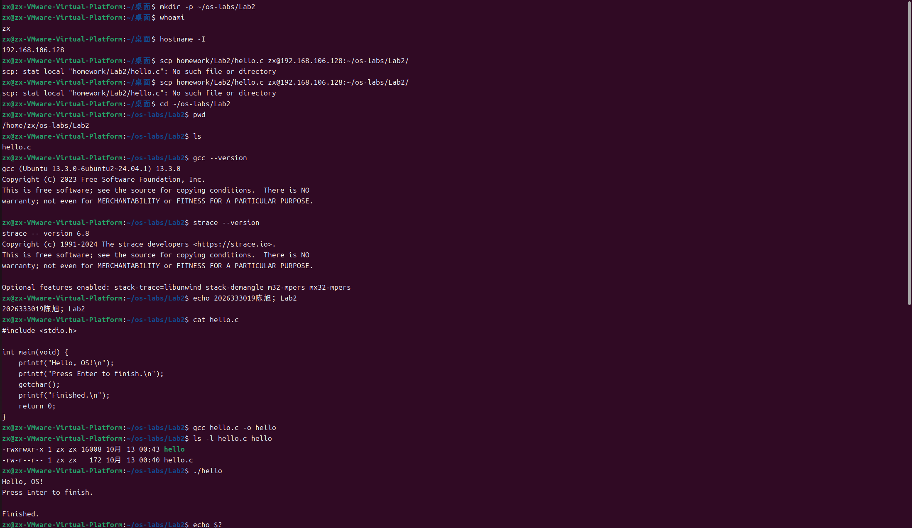
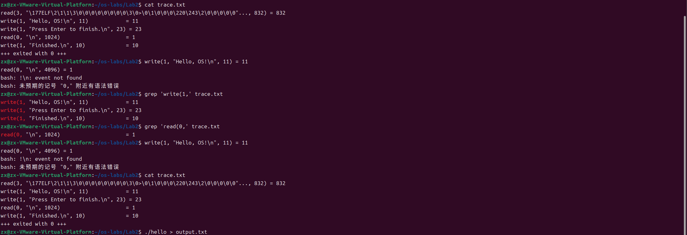

# Lab2：程序的编译、运行与系统调用观察

> **作业目标**：把讲义给出的 `hello.c` 送进 Ubuntu 虚拟机，编译并运行它，并用 strace 亲眼看到程序向操作系统发出的 read、write 请求。
>
> **前置条件**：已完成 Lab1 的环境验收（见仓库 `homework/Lab1/Lab1.md`）：虚拟机可用联网，`gcc`、`strace` 已安装，`openssh-server` 正在监听 22 端口，任务二的 Remote-SSH 和 scp 都要用它。
>
> **不需要会写 C**：本实验的全部代码由讲义给出，你只需要读懂它。
>
> **命令执行方式**：下面所有命令请**一条一条执行**，每执行一条就先看清它的输出再执行下一条。不要把一节里的命令一次性全部粘贴进终端，否则输出会混在一起，看不出是哪条命令出了问题。

---

## 任务一：分清两个目录，建好练习目录

### 第一步：分清两个目录

练习在虚拟机的 Ubuntu 里做，报告在自己的电脑上填，两边的文件不是同一份。

| 目录 | 在哪里 | 用途 | 里面应该有什么 |
| :--- | :--- | :--- | :--- |
| 仓库中的 `学号姓名/Lab2/` | 你自己的电脑（Windows/macOS） | 填报告、放截图、提交 | `Lab2.md` 和 `imgs/` 中的 2 张截图 |
| 虚拟机的 `~/os-labs/Lab2/` | Lab1 验收的那台 Ubuntu 虚拟机 | 编译和运行 | `hello.c`、`hello`、`trace.txt`，都不提交 |

先在本地电脑建好报告目录：在自己的仓库里新建 `学号姓名/Lab2/imgs/`，把教师仓库的 `homework/Lab2/Lab2.md` 复制进去，这份复制件就是要填的报告。文件夹名用 10 位学号紧接姓名，例如 `2026333001张三`；Windows 默认隐藏扩展名，注意别存成 `Lab2.md.txt`。

### 第二步：在虚拟机里建练习目录

打开虚拟机，在 Ubuntu 终端执行：

```bash
mkdir -p ~/os-labs/Lab2
```

`mkdir` 创建目录；`-p` 表示上层目录不存在时一并创建，已存在则不报错；`~` 表示当前登录用户的主目录。这条命令不会删除任何已有文件。

### 第三步：查看虚拟机的用户名和 IP

```bash
whoami
```

输出你的 Ubuntu 用户名，任务二连接虚拟机时要用。

```bash
hostname -I
```

输出虚拟机的 IP 地址，通常是 `192.168.x.x`。这两个值任务二要用，先记下来。

### 第四步：填写检查结果

| 项目 | 你的填写内容 |
| :--- | :--- |
| 本人学号、姓名 |2026333019陈旭 |
| Ubuntu 用户名（`whoami` 输出） |zx |
| 虚拟机 IP 地址（`hostname -I` 输出） | 192.168.106.128|
| 报告在本地仓库中的相对路径 |2026333019陈旭/Lab2/Lab2.md |

---

## 任务二：把 hello.c 送进虚拟机

`gcc`、`strace` 和终端都在虚拟机里，`hello.c` 却在你自己的电脑上。两种方式任选其一，效果相同：文件最终都要出现在虚拟机的 `~/os-labs/Lab2/` 里。

### 第一步：用 Remote-SSH 或 scp 把文件送进虚拟机

**方式一（推荐）：VS Code Remote-SSH。** VS Code 直接连到虚拟机，在虚拟机的目录里编辑文件、用虚拟机的终端编译运行。文件一直待在虚拟机里，不存在"传过去"这一步。

**① 安装扩展。** 在自己电脑的 VS Code 左侧打开扩展面板，搜索 `Remote - SSH`（发布者是 Microsoft），点击安装。

**② 添加主机。** 按 `Ctrl+Shift+P`（macOS 为 `Cmd+Shift+P`）打开命令面板，选择 `Remote-SSH: Add New SSH Host...`，填下面这行，用户名和 IP 换成任务一第三步查到的：

```text
ssh 你的Ubuntu用户名@虚拟机IP
```

回车后选择保存到 SSH 配置文件：Windows 是 `C:\Users\你的用户名\.ssh\config`，macOS 是 `~/.ssh/config`。

**③ 连接。** 再次打开命令面板，选择 `Remote-SSH: Connect to Host...`，选中刚才添加的主机。首次连接先问 `Select the platform of the remote host`，选 `Linux`；再输入 Ubuntu 的登录密码，即安装系统时设置的那个，输入时不显示字符。连接成功后左下角显示 `SSH: 虚拟机IP`。

**④ 打开练习目录。** 菜单 `File → Open Folder...`，路径填 `/home/你的用户名/os-labs/Lab2` 并回车，左侧列表显示的就是虚拟机里的这个目录。

**⑤ 新建 hello.c。** 在左侧文件列表右键 → `New File`，命名 `hello.c`，粘贴任务四给出的 8 行代码，按 `Ctrl+S` 保存。文件就写在虚拟机的 `~/os-labs/Lab2/` 里。

**⑥ 打开集成终端。** 菜单 `Terminal → New Terminal`。这个终端在虚拟机里，任务三到任务六的命令都可以在这里执行，不必切回虚拟机窗口。

> 提示 `Connection refused` 或一直停在 `Setting up SSH Host`：多半是 IP 填错了，或虚拟机没有监听 22 端口。回到任务一第三步重新确认 IP，并在虚拟机里执行 `ss -lnt | grep ':22'`，确认有 `LISTEN`。

**方式二：scp 传文件。** 不想装扩展，就在自己电脑的终端里把文件复制过去。Windows 自带 OpenSSH 客户端，PowerShell 或 Git Bash 都能用 `scp`；macOS 用自带终端。

**① 进入自己的仓库目录。** 在本地电脑打开终端，例如：

```bash
cd 你的仓库路径/OperatingSystem
```

**② 传送文件。** 用户名和 IP 换成任务一第三步查到的：

```bash
scp homework/Lab2/hello.c 你的Ubuntu用户名@虚拟机IP:~/os-labs/Lab2/
```

Windows PowerShell 里源文件路径写成 `.\homework\Lab2\hello.c`。冒号后面是虚拟机上的目标路径，结尾的 `/` 表示放进 `~/os-labs/Lab2/`。

第一次连接会提示 `Are you sure you want to continue connecting (yes/no)?`，输入 `yes` 回车；接着提示 `password:`，输入 Ubuntu 登录密码，同样不显示字符。传送完成后显示一行进度信息。

> 提示 `Permission denied`：用户名或密码不对，用户名以 `whoami` 的输出为准。
> 提示 `No such file or directory`：虚拟机上的 `~/os-labs/Lab2/` 还没建，先执行任务一第二步的 `mkdir -p ~/os-labs/Lab2`。
> 提示 `scp 不是内部或外部命令`：改用 Git Bash 执行，或先安装 OpenSSH 客户端。

### 第二步：核对文件已经在练习目录

在虚拟机终端执行：

```bash
cd ~/os-labs/Lab2
```

`cd` 改变当前目录，进入练习目录。

```bash
pwd
```

`pwd` 显示当前目录的完整路径，应以 `/home/你的用户名/os-labs/Lab2` 结尾。

```bash
ls
```

`ls` 列出当前目录的内容，应能看到 `hello.c`。看不到就先回到本节检查文件是否送到了这里，不要在找不到源文件时继续编译。后面所有命令都在这个目录里执行。

### 第三步：填写检查结果

| 项目 | 你的填写内容 |
| :--- | :--- |
| hello.c 通过哪种方式送进虚拟机 | Remote-SSH / scp |方法二
| 虚拟机练习目录的完整路径（`pwd` 输出） |/home/zx/os-labs/Lab2
 |
| Remote-SSH 或 scp 是否一次成功；若否，原因和解决过程 |scp一次成功 |

---

## 任务三：检查工具并留下身份标记

### 第一步：查看 gcc 版本

```bash
gcc --version
```

`--version` 查看版本。gcc 是编译器，任务五用它把 C 源码编译成可执行文件。记录第一行即可，补丁版本不要求与示例一致。

### 第二步：查看 strace 版本

```bash
strace --version
```

strace 用于跟踪 Linux 系统调用，任务六用它观察程序。如果提示 `command not found`，依次执行：

```bash
sudo apt update
```

```bash
sudo apt install strace
```

`sudo` 以管理员权限执行安装，输入密码时屏幕一般不显示字符。普通编译和运行不需要 `sudo`。

### 第三步：留下身份标记

```bash
echo '学号姓名：2026333001张三；Lab2'
```

`echo` 把引号内的文字原样打印出来，只用在这里让截图归属清楚，不是往 C 源码里加输出。单引号让整段文字作为一个整体交给 `echo`，里面的中文标点不会被当作命令分隔。换成自己的学号姓名。

### 第四步：填写检查结果

| 工具 | 版本第一行 | 是否可用；若不可用写修复方法 |
| :--- | :--- | :--- |
| gcc | | 是|
| strace | |是 |

---

## 任务四：读懂源码

`.md` 是描述"页面显示什么"的纯文本，`.c` 同样是纯文本，只是描述"机器依次做什么"。机器不能直接执行这些文字，必须先翻译成可执行文件，这一步叫编译，在任务五进行。

### 第一步：查看源码

```bash
cat hello.c
```

`cat` 显示文件的全部文字，输出应与下面一致。

```c
#include <stdio.h>

int main(void) {
    printf("Hello, OS!\n");
    printf("Press Enter to finish.\n");
    getchar();
    printf("Finished.\n");
    return 0;
}
```

> C 代码存放在文件里，不要把上面这段粘贴到 Shell 提示符后执行。

### 第二步：对照表格理解每一行

| 行/写法 | 做什么 | 易混点 |
| :--- | :--- | :--- |
| `#include <stdio.h>` | 引入标准输入输出头文件中的声明 | 编译前处理，不是运行时输出 |
| `int main(void)` | 定义主函数，返回整数，不通过参数收输入 | `(void)` 不妨碍从键盘读输入 |
| 花括号 `{ }` | 确定 main 里面有哪些语句 | 不是终端提示符 |
| `printf("...\n");` | 输出引号内文字，末尾换行 | 引号和分号用英文；`\n` 不是 `/n` |
| `getchar();` | 从标准输入读取一个字符 | 普通终端通常等输入一行后才交给程序 |
| `return 0;` | 正常结束 main，以 0 报告成功 | 0 不会自动打印在屏幕上 |

头文件只提供"有 printf 这个工具、怎么调用"的声明，printf 和 getchar 的实际实现由系统库提供，任务五编译时接上。空格、空行和缩进只影响阅读，分号表示语句结束。

### 第三步：运行前先写预测

下面三个问题先填写，再往下做：

| 问题 | 你的预测 |
| :--- | :--- |
| 未按回车时能看到哪几行 | 1 3 两行|
| 未按回车时，Shell 提示符是否已经回来 |是 |
| 按回车后新增哪一行 |第四行 |

---

## 任务五：编译并运行

### 第一步：编译

```bash
gcc hello.c -o hello
```

| 部分 | 含义 |
| :--- | :--- |
| `gcc` | 调用编译工具 |
| `hello.c` | 要翻译的源码文件 |
| `-o hello` | 把翻译结果保存为名为 `hello` 的文件；小写字母 `o` 后留空格 |

这条命令背后，gcc 自动连续做了四件事：预处理，把 `#include` 指到的头文件并入源码；编译和汇编，翻译成二进制目标文件；链接，把系统库里的 printf、getchar 接到程序上。本实验不要求分步操作，一条命令就够。

编译成功的标志：Shell 提示符回来，屏幕上没有任何以 `error` 开头的文字。出现报错时 gcc 会指出文件和行号，先读懂第一条，对照任务四的完整源码改正，再重新执行同一条命令。

### 第二步：查看编译产物

```bash
ls -l hello.c hello
```

`ls -l` 一行显示一个文件的详细信息。可执行文件 `hello` 通常带 `x` 权限，`hello.c` 仍是源码文字；只比较两者的存在和用途，不要求权限列或文件大小与同学一致。

### 第三步：运行并观察

```bash
./hello
```

`./` 表示从当前目录找 `hello`。直接写 `hello` 可能提示找不到命令，这不代表文件不存在。

先停住观察，**不要立刻按回车**：此时应看到问候和 `Press Enter to finish.`，没有 `Finished.`，提示符也没回来。只按一次回车后应出现 `Finished.`，提示符回来。等待期间不要输入命令，此刻终端在听 hello 说话，你输入的内容会交给 hello。

### 第四步：查看程序结束状态

```bash
echo $?
```

Shell 在每条命令结束后都会记录一个结束状态数字，`$?` 就是它的记号。这里应显示 `0`，正是源码最后一行 `return 0;` 交回给 Shell 的那个数，按约定表示正常结束。它必须紧跟 `./hello` 执行，中间插入别的命令，`$?` 记录的就是那条命令的状态了。

### 第五步：填写检查结果

| 项目 | 你的填写内容 |
| :--- | :--- |
| 本人实际执行的编译命令 |gcc hello.c -o hello
 |
| 编译成功后屏幕上有什么、没有什么 |-rwxrwxr-x 1 zx zx 16008 10月 13 00:43 hello
-rw-r--r-- 1 zx zx   172 10月 13 00:40 hello.c
 |
| 若出现过报错：第一条报错内容和你的修改 | |
| `hello.c` 是什么，`hello` 是什么 |hello.c 是源代码文件   hello 是可执行程序 |

| 观察点 | 本人实际结果 | 与预测是否相符 |
| :--- | :--- | :--- |
| 按回车之前 | |是 |
| 按回车之后 | |是 |
| 程序结束状态 | |0 
|

**解释：**为什么等待回车不等于程序崩溃？

> 填写：等待回车是 getcher() 函数造成的，程序本身还在正常运行.

保存第一张截图：身份标记、编译命令、运行命令、程序的完整输出。



---

## 任务六：用 strace 观察读写系统调用

`printf` 是 C 库函数，程序真正向操作系统请求输入输出时，走的是 `read`、`write` 这样的**系统调用**。本节用 strace 把程序发出的每一次系统调用记录下来。

### 第一步：跟踪运行

确认终端上是 Shell 提示符，没有另一个 hello 还占着终端，然后执行：

```bash
strace -o trace.txt -e trace=read,write ./hello
```

| 片段 | 含义 |
| :--- | :--- |
| `strace` | 启动并跟踪后面的程序 |
| `-o trace.txt` | 把跟踪记录写入当前目录的 `trace.txt`，重做会覆盖旧记录 |
| `-e trace=read,write` | 过滤，只记录 read 和 write 系统调用 |
| `./hello` | 被观察的程序 |

hello 自己的输出仍在终端上。看到等待提示后按一次回车，让它正常结束。

### 第二步：查看记录

```bash
cat trace.txt
```

记录可能比源码长。开头的某些 read 是运行库或加载器读取文件，不是你的键盘输入。我们要找的是第一参数为 0 的 read，以及第一参数为 1 且包含程序输出的 write。一屏太长时可以筛选：

```bash
grep 'write(1,' trace.txt
```

```bash
grep 'read(0,' trace.txt
```

`grep` 只显示包含指定文本的行。没有匹配时回到原始记录里找，不能凭示例补造一行。

### 第三步：读懂记录的形状

```text
write(1, "Hello, OS!\n", 11) = 11
read(0, "\n", 4096) = 1
```

这里的 `Hello, OS!` 连同换行符共 11 个字节；strace 可能截短或转义显示数据，字符数与字节数也不总相等。

| 位置 | 意义 |
| :--- | :--- |
| read / write | 内核读、写服务的系统调用名称 |
| 第一个参数 0 / 1 | 文件描述符：程序用来指代已打开的输入输出通道的整数编号，0 约定为标准输入，1 约定为标准输出，本次通常连着终端 |
| 数据文字 | strace 展示的数据，可能被截短或转义 |
| 请求长度 | 希望最多读取、或计划写出的字节数 |
| 等号后的值 | 实际读取、写入的字节数；失败会是负值并附原因 |

### 第四步：填写检查结果

填写本人记录中的真实行，可用行内代码，或在表后补代码块。

| 证据 | 本人从 trace.txt 中复制的一条记录 | 用中文解释它做了什么 |
| :--- | :--- | :--- |
| write，第一参数 1 | | 1, "Hello, OS!\n", 11|
| read，第一参数 0 | |0, "\n", 1024|

| 问题 | 你的答案 |
| :--- | :--- |
| read 的请求长度与实际返回长度分别是多少 |1 |
| 这是否意味着你键入了请求长度那么多字节 |是 |
| 除 0、1 之外是否看到其他文件描述符；如何看待它们 |是 |

保存第二张截图：跟踪命令、程序的完整输出、筛选出的两类真实记录。`trace.txt` 只留在练习目录，不提交。



---

## 任务七：用自己的话回答

每题 2—4 句话即可，不要求抄教材。

1. `hello.c`、`hello` 和正在等待输入的那次执行，分别是什么？

> 填写：hello.c 是源代码文件   hello 是可执行程序

2. `printf` 与 `write` 是什么关系？为什么不能用 printf 的行数直接预测 write 的次数？

> 填写：printf是C语言标准库的封装函数，printf内部会调用系统调用write来真正完成输出。

3. 本实验哪里用到了操作系统？请用你实际观察到的输入或输出说明，不要只写"管理资源"。

> 填写：运行 ./hello 的时候用到了操作系统  
输出： 
Press Enter to finish.

Finished. 

4. 本次遇到的一个问题、你的定位方法和最终状态；若没有遇到故障，写一个自己主动核对的步骤。

> 填写：没有遇到问题
./hello
Hello, OS!
Press Enter to finish.

Finished.
zx@zx-VMware-Virtual-Platform:~/os-labs/Lab2$ echo $?
0


---

## 选读：把输出送到文件

本节不要求执行、填写或截图。熟悉主线后可以试：

```bash
./hello > output.txt
```

`>` 由 Shell 处理，把标准输出写进 `output.txt`，同名文件会被覆盖。程序仍会等待终端输入，只是看不到提示，按一次回车后再 `cat output.txt` 查看。它说明输出目的地可以改变；重定向也会改变库的缓冲策略，所以不要把这个运行的 write 次数与交互运行强行对应。`output.txt` 也不提交。

---

## 常见问题

| 现象 | 先检查什么 | 怎样继续 |
| :--- | :--- | :--- |
| Remote-SSH 连不上 | IP 是否填错、22 端口是否监听 | 用 `hostname -I` 重新确认 IP，用 `ss -lnt \| grep ':22'` 确认有 `LISTEN` |
| scp 提示 `Permission denied` | 用户名或密码 | 用户名以 `whoami` 为准，密码是安装 Ubuntu 时设置的那个 |
| scp 提示 `No such file or directory` | 虚拟机侧目录是否建好 | 先执行 `mkdir -p ~/os-labs/Lab2` |
| 虚拟机里 `ls` 看不到 hello.c | 文件是否放进了 `~/os-labs/Lab2`；文件名是否多了 `.txt` | 用 `pwd`、`ls` 核对位置和文件名，必要时重新传送 |
| `hello.c: No such file or directory` | 当前目录是否是练习目录 | 回到任务二第二步确认，再编译 |
| 编译后没有任何输出 | 提示符是否回来、有没有 `error` 字样 | 无报错且提示符回来，通常就是成功 |
| `command not found: hello` | 是否漏了 `./` | 用 `./hello` |
| 编译报引号或分号错误 | 是否用了中文标点、是否删掉括号 | 对照任务四的完整源码修正第一条错误 |
| 运行停在 `Press Enter` | 是否正在正常等待输入 | 在同一终端只按一次回车 |
| 看不到 `read(0,...)` | 是否用了重定向、跟踪后是否正常输入 | 按课程命令重新交互运行一次 |
| 图片不显示 | 路径、大小写、下划线、扩展名 | 在报告同级 `imgs/` 保存后重新预览 |

不要用 `sudo` 运行 hello 来解决普通的编译或路径错误，也不要为了凑出预期输出去改系统权限设置。保留真实报错信息，比反复重装软件更容易定位问题。

---

## 自查表

| 自查项 | 是 / 否；若否说明原因 |
| :--- | :--- |
| 使用本人实验结果，保留了运行前的预测和运行后的解释 | |
| 本文件所有必做填写区均已完成 | |
| 共 2 张截图，文件名和大小写与下表完全一致 | |
| Markdown 预览中每张图片都能正常显示且文字可读 | |
| 只修改了自己的 10 位数字学号 + 姓名目录 | |
| 没有提交练习源码、可执行文件、跟踪日志或 IDE 配置 | |

---

## 截图要求

- 截图须清晰，终端文字可读，并同时显示命令和它的输出。
- 使用电脑自带的截图功能，严禁用手机拍摄屏幕。
- 截图里要能看到本人的身份标记（任务三的 `echo`），不得使用讲义示例或他人截图。
- 一张截图可以包含同一任务下的多条命令及其输出，但每条命令和它的输出必须能对应上。任务失败时保留真实输出，并在对应填写处说明，不能把示例数字改成自己的名字冒充实测。
- 所有截图放在报告同级的 `imgs/` 目录中，文件名与下表一致。

| 截图内容 | 文件名 |
| :--- | :--- |
| 身份标记、编译命令（无报错）、`./hello` 的完整输出 | `imgs/lab2_build_run.png` |
| strace 命令、本人程序输出、真实的 `write(1,...)` 与 `read(0,...)` | `imgs/lab2_syscalls.png` |

---

## 提交要求

在自己的「学号姓名」文件夹下新建 `Lab2/`，提交填写完整的 `Lab2.md` 和全部 2 张截图：

```text
学号姓名/
└── Lab2/
    ├── Lab2.md
    └── imgs/
        ├── lab2_build_run.png
        └── lab2_syscalls.png
```

> **注意**：`imgs` 全部小写；文件夹名和截图文件名区分大小写，必须与上面完全一致，否则图片引用会失效。文件名里的分隔符是**下划线 `_`**，不是减号 `-`。
>
> **只提交上面列出的文件。** 练习用的 `hello.c`、可执行文件 `hello` 和 `trace.txt` 请留在虚拟机的 `~/os-labs/Lab2` 里，不要复制进仓库。提交前用 `git status --short` 和 `git diff --cached --name-only` 确认本次变更只有 `Lab2.md` 和 2 张截图；PR 标题写成 `[学号姓名]Lab2作业提交`，其余步骤按仓库根目录 `README.md` 执行。

> **不要删除模板内容。** 题目、说明、示例、表格和「选读」都要保留，只在「填写」处作答；选读仍不要求执行或作答。审核会先比较你的报告与教师模板的行数和 Markdown 符号数量，删减题目会直接判为未完成。

---

## 截止时间

**2026 年 10 月 19 日 23:59:59**

按仓库 `README.md` 第 4 节的规则：不晚于 10 月 19 日 23:59:59 创建 PR 并完成最后一次推送不算超时，10 月 20 日 00:00 起新建 PR 或向已有 PR 推送任何修改均算作超时。时间按北京时间计算，并以 GitHub 记录的最后一次推送时间为准。审核未通过的同学请务必在截止前完成修改。
