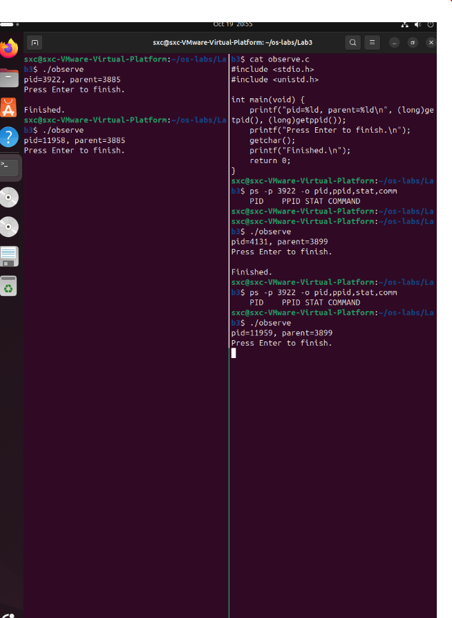
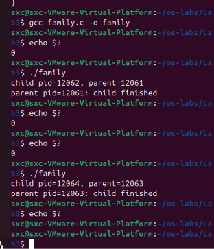

# Lab3：进程观察、父子关系与调度推演

> **作业目标**：用两个终端和 `ps` 观察同一份程序的两个进程，读懂 PID、PPID 与 STAT；读懂并运行一次 `fork`，验证父子关系与输出顺序；最后用纸面模型推演 FCFS 与时间片轮转。对应第 02 次课「CPU 与进程」。
>
> **前置条件**：已完成 Lab1 的环境验收和 Lab2（见仓库 `homework/Lab1/Lab1.md`、`homework/Lab2/Lab2.md`）：Ubuntu 虚拟机可用，`gcc`、`strace` 已装好，会编译、运行程序。本实验新用到的观察工具是 `ps`，用法和判读都在题目里给出。
>
> **不需要会写 C**：两段代码由讲义给出，实验只要求读懂、运行和解释。`fork`、`waitpid` 是本实验的新内容，题目里逐个解释了写法，不要求从空白编写；本实验不要求编写循环创建进程，也不要求实现 Shell。
>
> **课前准备**：按任务一建好练习目录，并把 `observe.c`、`family.c` 按 Lab2 学过的方式送进虚拟机。
>
> **课堂用法**：前 45 分钟理论课建立进程与调度的模型；后 45 分钟在课堂上完成「任务二至任务七」的操作与记录；任务八、截图整理与提交在课后完成，约 30 分钟。
>
> **命令执行方式**：下面所有命令请**一条一条执行**，每执行一条就先看清它的输出再执行下一条。不要把一节里的命令一次性全部粘贴进终端，否则输出会混在一起，看不出是哪条命令出了问题。

---

## 任务一：准备练习目录，把源码送进虚拟机

练习在虚拟机的 Ubuntu 里做，报告在自己的电脑上填，两边的文件不是同一份。

| 目录 | 在哪里 | 用途 | 里面应该有什么 |
| :--- | :--- | :--- | :--- |
| 仓库中的 `学号姓名/Lab3/` | 你自己的电脑（Windows/macOS） | 填报告、放截图、提交 | `Lab3.md` 和 `imgs/` 中的 2 张截图 |
| 虚拟机的 `~/os-labs/Lab3/` | Lab1 验收的那台 Ubuntu 虚拟机 | 编译和运行 | `observe.c`、`family.c`、`observe`、`family`，都不提交 |

先在本地电脑建好报告目录：在自己的仓库里新建 `学号姓名/Lab3/imgs/`，把教师仓库的 `homework/Lab3/Lab3.md` 复制进去，这份复制件就是要填的报告。文件夹名用 10 位学号紧接姓名，例如 `2026333001张三`；Windows 默认隐藏扩展名，注意别存成 `Lab3.md.txt`。

### 第一步：在虚拟机里建练习目录

打开虚拟机，在 Ubuntu 终端执行：

```bash
mkdir -p ~/os-labs/Lab3
```

`mkdir` 创建目录；`-p` 表示上层目录不存在时一并创建，已存在则不报错；`~` 表示当前登录用户的主目录。这条命令不会删除任何已有文件。

### 第二步：把 observe.c 和 family.c 送进虚拟机

`observe.c` 和 `family.c` 在你自己电脑的仓库里，虚拟机里没有这两个文件。按 Lab2 任务二学过的方式任选其一，把两个文件都放进虚拟机的 `~/os-labs/Lab3/`。

**方式一（推荐）：VS Code Remote-SSH。** 连上虚拟机后，用 `File → Open Folder...` 打开 `/home/你的用户名/os-labs/Lab3`，在左侧右键新建 `observe.c` 和 `family.c`，把「任务二」和「任务五」给出的完整代码原样粘贴进去，按 `Ctrl+S` 保存。文件直接写在虚拟机里，不需要另外传送。

**方式二：scp 传文件。** 在自己电脑的终端里执行（用户名和 IP 按 Lab1、Lab2 的方式查到；Windows 把源文件路径写成 `.\homework\Lab3\observe.c` 这样）：

```bash
scp homework/Lab3/observe.c 你的Ubuntu用户名@虚拟机IP:~/os-labs/Lab3/
```

```bash
scp homework/Lab3/family.c 你的Ubuntu用户名@虚拟机IP:~/os-labs/Lab3/
```

第一次连接会问 `Are you sure you want to continue connecting (yes/no)?`，输入 `yes` 回车；随后提示 `password:`，输入 Ubuntu 登录密码，输入时不显示字符。

> 提示 `No such file or directory`：虚拟机上的 `~/os-labs/Lab3/` 还没建，先执行第一步的 `mkdir -p ~/os-labs/Lab3`。提示 `Permission denied`：用户名或密码不对，用户名以 `whoami` 的输出为准。
>
> `launch.c` 是选读，暂不传送也可以；做选读一节时再按同样方式送一次。

### 第三步：核对文件已经在练习目录

在虚拟机终端执行：

```bash
cd ~/os-labs/Lab3
```

`cd` 改变当前目录，进入练习目录。

```bash
pwd
```

`pwd` 显示当前目录的完整路径，应以 `/home/你的用户名/os-labs/Lab3` 结尾。

```bash
ls
```

`ls` 列出当前目录的内容，应能看到 `observe.c` 和 `family.c`。看不到就先回到第二步检查文件是否送到了这里，不要在找不到源文件时继续编译。后面所有命令都在这个目录里执行。

### 第四步：开两个终端，明确分工

本实验需要两个能同时操作的终端。推荐用 `tmux` 在一个窗口里分屏，截图时两个终端天然并排；也可以直接开两个 Ubuntu 终端窗口，效果相同。

**安装 tmux**（已经装好可跳过）：

```bash
sudo apt install tmux
```

**分屏**：执行下面的命令启动 tmux：

```bash
tmux
```

进入 tmux 后，按一次 `Ctrl+b` 松开、再按 `%`，窗口左右分成两个窗格，每个窗格是一个独立终端。

**切换**：按一次 `Ctrl+b` 松开、再按方向键 `←` `→`，输入焦点就在两个窗格之间移动。

**退出**：实验做完后，在每个窗格里执行：

```bash
exit
```

两个窗格都退出后，tmux 会话自动结束。

**暂时离开**：按一次 `Ctrl+b` 松开、再按 `d` 可以先离开 tmux，会话继续在后台运行；之后执行：

```bash
tmux attach
```

就能回到原来的两个窗格。关闭终端窗口或 SSH 断线后，也可以用这个命令恢复。

把左边那个终端叫**终端 A**，右边那个叫**终端 B**。两个终端都执行：

```bash
cd ~/os-labs/Lab3
```

两个终端能访问同一文件，但各自有自己的 Shell、当前目录和正在运行的命令：A 在等待输入，不妨碍 B 执行 `ps`；B 敲回车也不会被 A 的程序收到。

| 终端 | 前半段任务 | 后半段任务 |
| :--- | :--- | :--- |
| A | 启动 observe，停在等待点 | 运行 family |
| B | 用 ps 观察 A，然后再启动一个 observe | 保留输出供对照 |

### 第五步：填写检查结果

| 项目 | 你的填写内容 |
| :--- | :--- |
| 本人学号、姓名 |2026333037谌相呈|
| observe.c、family.c 通过哪种方式送进虚拟机 | Remote-SSH / scp |scp
| 练习目录的完整路径（`pwd` 输出） |/home/sxc/os-labs/Lab3 |
| 是否一次成功；若否，原因和解决过程 |是 |

---

## 任务二：读懂 observe 并编译

### 第一步：查看源码

```bash
cat observe.c
```

`cat` 显示文件的全部文字，输出应与下面一致。

```c
#include <stdio.h>
#include <unistd.h>

int main(void) {
    printf("pid=%ld, parent=%ld\n", (long)getpid(), (long)getppid());
    printf("Press Enter to finish.\n");
    getchar();
    printf("Finished.\n");
    return 0;
}
```

上次已解释 C 程序的基本框架。本次新内容都在下表，不要求先读完整 POSIX 手册：

| 写法 | 解释 |
| :--- | :--- |
| `<unistd.h>` | Unix/POSIX 接口相关头文件，提供本次进程查询函数的声明 |
| `getpid()` | 返回当前进程 PID |
| `getppid()` | 返回父进程 PID |
| `%ld` | 按 long 有符号整数显示，`l` 是小写字母 L |
| `(long)` | 把后面的 PID 值转换为 long，匹配输出格式 |
| 函数调用中的逗号 | 分隔参数；两个 PID 依次填进两个占位符 |

PID 是系统用来区分活动进程的编号，不是本次 CPU 使用量；PPID 不是「前一个进程的 PID」，而是父进程 ID。

### 第二步：编译并检查结束状态

```bash
gcc observe.c -o observe
```

| 部分 | 含义 |
| :--- | :--- |
| `gcc` | 调用编译工具 |
| `observe.c` | 要翻译的源码文件 |
| `-o observe` | 把翻译结果保存为名为 `observe` 的文件；小写字母 `o` 后留空格 |

```bash
echo $?
```

应显示 `0`，且编译时没有以 `error` 开头的文字。有警告或错误时，先读懂第一条，对照上面的完整源码修正，再重新执行同一条命令。

### 第三步：填写检查结果

| 项目 | 你的填写内容 |
| :--- | :--- |
| 本人实际执行的编译命令 |gcc observe.c -o observe |
| 编译状态（`echo $?` 的输出） | 0|
| 若有警告或错误：第一条内容和你的修改 |无错误|

---

## 任务三：运行 observe，观察进程状态

### 第一步：在 A 运行，停在等待点

在终端 A 执行：

```bash
./observe
```

输出形状如下，数字仅为示例：

```text
pid=2401, parent=2320
Press Enter to finish.
```

**先记下本人 PID 和 parent，不要按回车。** 2401 只是示例，下面查询必须替换成自己刚看到的真实数字。

### 第二步：在 B 用 ps 查询

假设本人刚得到 2401，在终端 B 执行：

```bash
ps -p 2401 -o pid,ppid,stat,comm
```

| 片段 | 含义 |
| :--- | :--- |
| `ps` | 查看进程状态快照 |
| `-p 2401` | 只选择这个 PID；替换成 A 打印的真实数字 |
| `-o` | 指定输出哪些字段 |
| `pid,ppid,stat,comm` | 依次为 PID、父 PID、状态标记、命令名；逗号间不加空格 |

典型结果：

```text
    PID    PPID STAT COMMAND
   2401    2320 S+   observe
```

第一行是列标题。`S` 表示可中断睡眠，本场景通常在等终端输入；`+` 表示属于终端的前台进程组。`R` 在 Linux 工具里可以同时表示正在运行或可运行，不能直接等同于课堂三状态模型中唯一的「运行」。`ps` 只给出查询那一刻的状态快照，要写下实际结果，再结合是否处于等待点解释，不能为了匹配讲义示例而改截图。

### 第三步：填写检查结果

| 字段 | observe 自己输出 | ps 查询输出 | 是否一致或如何解释 |
| :--- | :--- | :--- | :--- |
| PID |3922 |3922 |一致，查询到的进程就是当前正在等待输入的observe进程 |
| PPID |3885 |3885 | 一致，observe的父进程编号匹配，父进程就是终端shell|
| STAT | 不由 observe 显示 | S+|  S：可中断睡眠，程序阻塞在getchar()等待键盘输入；+：前台进程组 |
| COMM | 不由 observe 显示 |observe | COMM代表进程对应的可执行文件名observe |

**解释：**当前程序在等什么？为什么这时 CPU 还可以处理 B 的 `ps` 命令？

> 填写：当前程序执行到 getchar() ，正在阻塞等待终端A的键盘回车输入。observe处于可中断睡眠S状态，主动让出CPU资源，不会一直占用CPU。Linux操作系统具备多进程并发调度能力，可以切换CPU去执行终端B里面的ps查询命令，实现多个终端任务同时处理。

若结果不是 `S`，先如实记下，并确认 A 是否还停在等待处，可以再查询一次观察状态是否变化。不要求反复采样直到得到想要的字母。

---

## 任务四：同一份文件的两个进程

### 第一步：在 B 再启动一个 observe

确认 A 仍在等待。在 B 刚才的 `ps` 完成、提示符回来后执行：

```bash
./observe
```

现在 B 也停在等待提示。不要立刻按回车，先对比两边输出。

| 比较项 | A 中的运行 | B 中的运行 |
| :--- | :--- | :--- |
| 可执行文件名 |observe | observe|
| 实际 PID |3922 |4131 |
| 实际 PPID |3885 |3899 |
| 是否仍在等待回车 |是 |是 |

**解释：**为什么同一份文件可以有两个 PID？两个 PPID 是否必须相同？结合你使用两个 Shell 的实际情况说明。

> 填写：同一份磁盘上的可执行文件，可以被操作系统多次加载，每一次启动程序都会新建独立进程，操作系统会为每一个进程分配独一无二的PID，因此同一个程序文件能够产生多个不同PID。
两个PPID不必相同。终端A、终端B是两个相互独立的终端Shell会话。A中observe的父进程是A终端的Shell，B中新observe的父进程是B终端的Shell，两个Shell本身PID不一样，因此两个observe的PPID不相同。

### 第二步：画两条父子链

把这次的两个运行各写成一条小链（这也是「进程树」的一段）：

| 链路 | 父（Shell）的 PID | 子（observe）的 PID |
| :--- | :--- | :--- |
| 终端 A 这一支 | 3885 | 3992 |
| 终端 B 这一支 | 3899 | 4131 |

**回答：**两条链的「父」为什么是不同的数字？

> 填写：终端A、终端B是两个相互独立打开的终端窗口，各自运行一个独立的Shell进程，两个Shell拥有不一样的PID。
终端A中的observe进程是A窗口的Shell创建出来；终端B中新启动的observe进程是B窗口的Shell创建出来。两个observe的父进程分属于两个不同终端会话，因此两条链路父进程PID数字不一样。

保存第一张截图：终端 A 和终端 B 并排显示，A 中的 PID、B 先前的 `ps` 命令及结果、B 新启动的另一个 PID 都应可读。此时只是观察等待中的两个进程，截图不需要再开第三个终端。



### 第三步：分别结束，再复查

先在 B 按一次回车，让 B 的 observe 结束；再在 A 按一次回车，让 A 的 observe 结束。两边出现 `Finished` 并返回各自 Shell 提示符。

回到 B，重新执行刚才查询 A 的 `ps` 命令，仍使用 A 原来的 PID（把命令里的 2401 换成 A 的实际 PID）：

```bash
ps -p 2401 -o pid,ppid,stat,comm
```

通常不再有对应数据行，可能只剩表头；这是被查询的进程已退出，不是 `ps` 坏了。紧接着检查结束状态：

```bash
echo $?
```

在没有所选进程时可能是非零；结束状态要结合命令的具体语义解释，不能一看到非零就认定操作系统故障。

| 项目 | 本人结果 |
| :--- | :--- |
| 结束后查询的实际命令 |ps -p 3922 -o pid,ppid,stat,comm |
| `ps` 实际输出/是否仍有数据行 |没有 |
| 紧接 `ps` 的结束状态 | 1|
| 磁盘上的 observe 文件是否仍然存在；怎样检查 |文件仍然存在；使用ls observe命令，如果能够列出文件名就证明磁盘上的可执行文件没有被删除 |

PID 将来可以复用，因此这一步应紧接退出完成。若仍有行，要核对 COMMAND 和进程是否确实结束，不直接填「失败」。

---

## 任务五：读懂 family 的两条执行路径

### 第一步：查看源码

```bash
cat family.c
```

输出应与下面一致。

```c
#include <stdio.h>
#include <unistd.h>
#include <sys/wait.h>

int main(void) {
    pid_t child = fork();
    if (child < 0) {
        perror("fork");
        return 1;
    }
    if (child == 0) {
        printf("child pid=%ld, parent=%ld\n", (long)getpid(), (long)getppid());
        return 0;
    }
    if (waitpid(child, NULL, 0) < 0) {
        perror("waitpid");
        return 1;
    }
    printf("parent pid=%ld: child finished\n", (long)getpid());
    return 0;
}
```

这个程序正常情况下只创建一个孩子。子进程不会重新从 `main` 第一行开始；它与父进程都从 `fork` 返回后的地方继续。

| fork 结果 | 谁接到它 | 后续行为 |
| :--- | :--- | :--- |
| -1 | 创建失败的原进程 | 打印错误并返回 1 |
| 0 | 新子进程 | 打印子信息并返回 0 |
| 大于 0，值为子 PID | 父进程 | 等这个孩子结束，再打印完成 |

### 第二步：对照表格认识每一种新写法

| 写法 | 作用 |
| :--- | :--- |
| `<sys/wait.h>` | 等待进程相关接口的头文件 |
| `pid_t child` | 声明保存 PID 类数值的变量 child |
| `= fork()` | 调用 fork，把返回值存入 child |
| `if (...)` | 条件成立才执行相应花括号内的语句 |
| `< 0` | 比较是否小于 0 |
| `== 0` | 比较是否等于 0；不要与赋值的单等号混淆 |
| `perror("...")` | 向标准错误报告系统失败原因，便于排错 |
| `return 1` | 用非零结束状态报告本例失败 |
| `waitpid(child, NULL, 0)` | 等指定孩子；不保存详细退出状态；使用默认等待选项 |
| `NULL` | 空指针常量，在这里表示不提供保存退出状态的位置 |

`fork` 与 `waitpid`（属于 `wait` 一类的等待调用）和 `read`、`write` 一样，都是**系统调用**，不是普通的库函数：创建进程、等待子进程都由内核完成，C 库里的同名接口只是替我们发起请求。

子分支里有 `return`，所以子进程不会继续执行后面的 `waitpid`。父进程的 `child` 是正数，因此跳过子分支；`waitpid` 成功后才打印完成行。

### 第三步：运行前先写预测

| 问题 | 你的预测 |
| :--- | :--- |
| 正常应有几行进程信息 |2行 |
| child 行与 parent 完成行哪个先出现；根据什么 | child行先出现父进程调用了，父进程会阻塞等待子进程执行完毕之后，才会继续向下执行、打印parent完成行。所以一定是子进程输出先打印出来|
| 子进程的 parent 字段应与哪一个数字相等 | 子进程的parent（PPID） = 父进程自身的PID也就是执行 ./family 这个父进程的pid，子进程的父进程编号就是父进程pid|

---

## 任务六：运行 family，验证父子关系

### 第一步：编译并运行

在已经返回 Shell 提示符的 A 执行（与任务二的编译形状相同，只换了文件名）：

```bash
gcc family.c -o family
```

```bash
echo $?
```

编译成功再执行：

```bash
./family
```

family 不会等待键盘，一般很快结束。然后检查结束状态：

```bash
echo $?
```

再运行一次 family，对比数字与关系：

```bash
./family
```

然后检查结束状态：

```bash
echo $?
```

两个运行的 PID 通常不同；要检验的是「父子关系与顺序」，不是要求每次数字相同。

### 第二步：填写检查结果

| 运行 | 子 pid | 子行中的 parent | 父完成行的 pid | 输出顺序 | 结束状态 |
| :--- | :--- | :--- | :--- | :--- | :--- |
| 第一次 |12062 |12061 |12061 |child行先输出，之后parent完成行 | 0|
| 第二次 |12064 |12063 |12063 | child行先输出，之后parent完成行|0 |

**回答：**

1. 本例中的 fork 返回 0 是否意味着子 PID 为 0？

> 填写：不是。fork 的返回值等于0仅仅是一个标记，用于区分当前执行流属于子进程，并不是子进程的PID。从实验结果可见子进程PID为12062、12064，都不为0。

2. 如果只看 C 文件中哪一行写在上面，能否一般地判断父子执行先后？本例的 `waitpid` 提供了什么保证？

> 填写：不能仅靠源码上下位置判断父子进程执行先后，fork之后父子进程是并发执行，调度顺序由操作系统内核决定。
本例中 waitpid 会阻塞父进程，强制父进程原地等待目标子进程执行完毕之后，父进程才会继续向下执行代码，保证子进程的输出一定先于父进程完成行输出。

3. `waitpid` 除了「等一下」还收取了什么信息？为什么本例传 `NULL` 仍可以完成等待？

> 填写：waitpid还可以接收子进程的退出状态信息，可以拿到子进程退出码。
参数位置传入NULL代表不需要保存、读取子进程的退出状态，只单纯实现等待子进程结束这个功能，因此传入NULL依旧可以正常完成等待。

保存第二张截图：family 的编译命令、两次真实运行及其结束状态，数字应清楚。



---

## 任务七：用小模型解释 CPU 分配

这部分**手算填写，在课堂上独立完成并当场核对**；不运行调度模拟器，不需要截图。它是对课堂调度模型（FCFS 与轮转）的一次纸上验证，不反映本机 Linux 实际使用了什么调度策略。

统一假设：一个 CPU；A、B 都在时刻 0 到达；初始 A 排在 B 前；A 需要 3 个时间单位、B 需要 2 个；不发生 I/O，不计切换开销；时间从 0 开始。

### 第一步：先来先服务 FCFS

先来的任务开始后一直做完，再给下一个。填每个单位时间 CPU 属于谁：

| 区间 | 0—1 | 1—2 | 2—3 | 3—4 | 4—5 |
| :--- | :--- | :--- | :--- | :--- | :--- |
| FCFS 任务 |A |A |A |A |A |

### 第二步：时间片轮转 RR

时间片为 1。没有完成的任务用完一片放到队尾，完成的离开队列。A 先获得第一个时间片。

| 区间 | 0—1 | 1—2 | 2—3 | 3—4 | 4—5 |
| :--- | :--- | :--- | :--- | :--- | :--- |
| RR 任务 |A |B |A |B |A |

### 第三步：再算三个指标

响应时间＝首次获 CPU 时刻 − 到达时刻。
周转时间＝完成时刻 − 到达时刻。
本题等待时间＝周转时间 − CPU 需求量，因为本题没有 I/O 等待。

完成时刻取区间右端：若最后运行在 3—4，完成时刻为 4，不是 3。

| 算法 | 任务 | 首次获 CPU | 完成时刻 | 响应时间 | 周转时间 | 等待时间 |
| :--- | :--- | :--- | :--- | :--- | :--- | :--- |
| FCFS | A |0|3 |0 |3 |0 |
| FCFS | B | 3|5 |3 |5 |3 |
| RR | A |0 |5 | 0|5 | 2|
| RR | B |1 |4 | 1| 4|2 |

**用表中自己的数字回答：**轮转使哪个任务更早得到首次响应？是否每个任务都更早完成？

> 填写：轮转使得任务B更早得到首次响应。并不是每个任务都更早完成，对比数据：B在RR下首次获得CPU时刻为1，早于FCFS的3；但是任务A的完成时刻从FCFS的3延后到RR的5，A完成时间变晚。

若把时间片改得非常小，真实机器还需要考虑哪些本题忽略的开销？写一个即可。

> 填写：进程上下文切换开销（切换进程时保存、恢复寄存器等现场所带来的时间开销

---

## 任务八：用自己的话回答

每题 2—4 句话即可，不要求抄教材。

1. 等待键盘的 observe 属于课堂三状态模型中的哪种状态？如果 `ps` 显示 `R`，为什么不能把 `R` 机械地只译成「已经占有 CPU」？

> 填写：等待键盘输入的进程属于阻塞（等待）状态。ps标记R代表运行态，它包含两种情况：进程正在CPU上执行，或是已经就绪、排在就绪队列等待CPU调度，因此不能直接等同于正在占有CPU

2. 用自己的话区分并发和并行；本题单 CPU 的两种调度属于什么情况？

> 填写：并发是多个任务交替复用同一CPU，宏观上同时推进；并行是多个任务在多个CPU核心上真正同时执行。本次单CPU下FCFS与RR调度都属于并发，同一时刻最多只能有一个进程运行

3. 一句话区分「进程的编号」「进程状态」「调度次序」。

> 填写：进程编号PID是进程唯一身份标识；进程状态描述进程当前所处状态，例如就绪、阻塞、运行；调度次序代表操作系统选择进程上CPU执行的先后顺序

4. 本次遇到的一个问题、你的定位方法和最终状态；若没有遇到故障，写一个自己主动核对的步骤。

> 填写：
实验中遇到Git提交时误将Lab1文件带入PR的问题。我通过查看git变更列表定位多余文件，新建干净分支重新提交，最终成功提交仅包含Lab2文件的Pull Request
---

## 选读：程序替换 exec

本节不要求执行、填写或截图。教师提供 `launch.c`，完整代码及每个新写法已放在第 02 次讲义第 7 节；先读后操作，不必从网络另找复杂示例。

从仓库 `homework/Lab3/launch.c` 复制到练习目录，编译：

```bash
gcc launch.c -o launch
```

```bash
./launch
```

程序先打印当前 PID，再调用 `execl` 把自身程序替换为 `/bin/echo`。成功时旧程序不会继续执行后面的 `perror`；失败时才会显示诊断。

若想观察，可用 Lab2 已有 strace：

```bash
strace -e trace=execve ./launch
```

这里没有 `-o`，跟踪信息直接显示在终端；`trace=execve` 只选择执行程序映像替换的系统调用。通常能看到启动 launch 和替换为 echo 的两次成功 `execve`，返回 0 表示该替换调用成功。`execl` 是库接口名，`execve` 是此处跟踪到的系统调用名。

本命令没有 `-f`，不追踪另建的子进程；观察到的成功替换发生在所跟踪的同一进程中。不能把「两条 execve 记录」误认作「两次 fork」。

想把「创建与等待」也一起看到，可以另外运行（选做，不增加截图）：

```bash
strace -f -e trace=process ./family
```

`-f` 跟随新建的子进程；`trace=process` 只选择进程相关系统调用（fork/clone、execve、wait4、exit 等）。名字以实际输出为准：较新的系统库里，fork 常表现为 clone。

可选记录：你怎样区分 fork 创建与 exec 替换？

> 选做填写；未做写「未做」：

---

## 常见问题

| 现象 | 先检查什么 | 怎样继续 |
| :--- | :--- | :--- |
| ps 只显示表头 | A 是否已退出、PID 是否抄错、查询是否太晚 | 重新启动，使用本次实际 PID，停在等待处再查 |
| A 有等待提示，B 却找不到 PID | B 是否在同一个 Ubuntu 环境 | 确认不是 Windows 终端或另一台虚拟机 |
| B 输入命令后没有执行 | B 自己的 observe 是否尚未结束 | 先按回车等提示符回来 |
| 两次运行 PID 不相同 | 是否在比较「固定数字」 | 正常，创建了不同进程；比较父子关系和状态，不追求固定数字 |
| 输出出现 `S+` 而不是 `S` | 是否把前台标记当成了状态 | 先读首字母，再解释 `+` |
| family 只输出 fork 错误 | 系统是否未能创建子进程 | 记录 perror 信息，关闭无关任务并请教师协助 |
| family 出现 waitpid 错误 | 等待调用是否失败 | 保留完整输出，不当成正常两行结果 |
| 父子编号关系看起来不符 | 是否把两次运行的行混在一起 | 一次运行作为一组填写 |
| RR 总共用了 6 格 | CPU 需求总量是否为 3+2=5 | 删除多算的时间，不安排已完成任务 |
| 把 `S` 写成 CPU 忙等 | 是否混淆阻塞与运行 | 结合 getchar 等待事件重新解释 |

保留真实异常不会自动使整个报告失去价值，但需要写明尚未完成的目标，不能把失败输出描述为验证成功。

---

## 自查表

| 自查项 | 是 / 否；若否说明原因 |
| :--- | :--- |
| 使用本人实验结果，保留运行前的预测与运行后的解释 | |
| 本文件所有必做填写区均已完成 | |
| 共 2 张截图，文件名和大小写与下表完全一致 | |
| Markdown 预览中每张图片都能正常显示且文字可读 | |
| 只修改了自己的 10 位数字学号 + 姓名目录 | |
| 没有提交练习源码、可执行文件、跟踪日志或 IDE 配置 | |

---

## 截图要求

- 截图须清晰，终端文字可读，并同时显示命令和它的输出。
- 使用电脑自带的截图功能，**严禁用手机拍摄屏幕**。
- 截图须是本人机器的真实输出，不得使用讲义示例或同学截图。
- 一张截图可以包含同一任务下的多条命令及其输出，但每条命令和它的输出必须能对应上。任务失败时保留真实输出，并在对应填写处说明，不能把示例数字改成自己的名字冒充实测。
- 文字过小时先增大终端字体再截图。所有截图放在报告同级的 `imgs/` 目录中，文件名与下表一致。

| 截图内容 | 文件名 |
| :--- | :--- |
| A 的 PID，B 对 A 的 `ps` 命令及结果，B 第二次启动的不同 PID | `imgs/lab3_process.png` |
| family 的编译命令、两次 family 输出及其结束状态 | `imgs/lab3_family.png` |

---

## 提交要求

在自己的「学号姓名」文件夹下新建 `Lab3/`，提交填写完整的 `Lab3.md` 和全部 2 张截图：

```text
学号姓名/
└── Lab3/
    ├── Lab3.md
    └── imgs/
        ├── lab3_process.png
        └── lab3_family.png
```

> **注意**：`imgs` 全部小写；文件夹名和截图文件名区分大小写，必须与上面完全一致，否则图片引用会失效。文件名里的分隔符是**下划线 `_`**，不是减号 `-`。
>
> **只提交上面列出的文件。** 练习用的 `observe.c`、`family.c`、`launch.c` 和编译出的可执行文件请留在虚拟机的 `~/os-labs/Lab3` 里，不要复制进仓库。选读的答案只填写在本报告相应区域，不额外提交截图、源码或结果文件。
>
> 提交前先确认本次变更只有 `Lab3.md` 和 2 张截图：
>
> ```bash
> git status --short
> ```
>
> ```bash
> git diff --cached --name-only
> ```
>
> PR 标题写成 `[学号姓名]Lab3作业提交`，其余步骤按仓库根目录 `README.md` 执行，不要自行修改 `.github/` 或课程审核配置。

> **不要删除模板内容。** 题目、说明、示例、表格和「选读」都要保留，只在「填写」处作答；选读仍不要求执行或作答。审核会先比较你的报告与教师模板的行数和 Markdown 符号数量，删减题目会直接判为未完成。

---

## 截止时间

**2026 年 10 月 26 日 23:59:59**

按仓库 `README.md` 第 4 节的规则：不晚于 10 月 26 日 23:59:59 创建 PR 并完成最后一次推送不算超时，10 月 27 日 00:00 起新建 PR 或向已有 PR 推送任何修改均算作超时。时间按北京时间计算，并以 GitHub 记录的最后一次推送时间为准。审核未通过的同学请务必在截止前完成修改。
